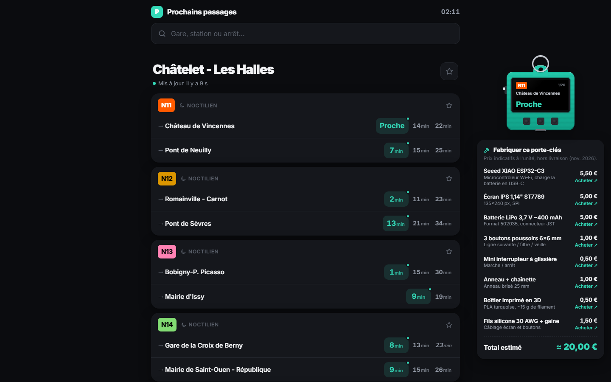

# Prochains passages · Île-de-France

Temps d'attente en temps réel de tous les transports d'Île-de-France : métro, RER, Transilien, tram, bus et Noctilien.

**▶ Démo : https://frcynda.github.io/paris-transports/**

Exemples : [Châtelet - Les Halles](https://frcynda.github.io/paris-transports/#IDFM:474151) · [Gare de Lyon](https://frcynda.github.io/paris-transports/#IDFM:73626) · [La Défense](https://frcynda.github.io/paris-transports/#IDFM:71517)

## Fonctionnalités

- Recherche de n'importe quel arrêt d'Île-de-France. Les pôles (ex. Châtelet - Les Halles) regroupent métro, RER et bus.
- Prochains passages par ligne et par direction, mis à jour toutes les 30 s, avec la couleur officielle de chaque ligne.
- Temps réel signalé par un point vert ; les horaires théoriques sont en italique, les trains supprimés barrés.
- Filtres par mode, arrêts favoris, lignes épinglées en haut, arrêts récents.
- Chaque arrêt a son lien (`#IDFM:…`), à partager ou mettre en favori.
- Thème clair / sombre automatique, adapté au mobile.
- Un porte-clés virtuel qui affiche le prochain départ, avec la liste des pièces (≈ 20 €) pour le fabriquer pour de vrai.

## Aucune clé API

Les données viennent de l'API publique de [Transitous](https://transitous.org), qui agrège les horaires et le temps réel publiés par [Île-de-France Mobilités](https://prim.iledefrance-mobilites.fr). Pas de compte, pas de clé, pas de serveur.

## Lancer en local

Ouvrir `index.html` dans un navigateur. C'est tout : deux fichiers (`index.html`, `app.js`), aucune dépendance.

## Limites

- Transitous est un service communautaire bénévole, sans garantie de disponibilité.
- Toutes les lignes ne publient pas de temps réel ; dans ce cas l'horaire théorique est affiché.
